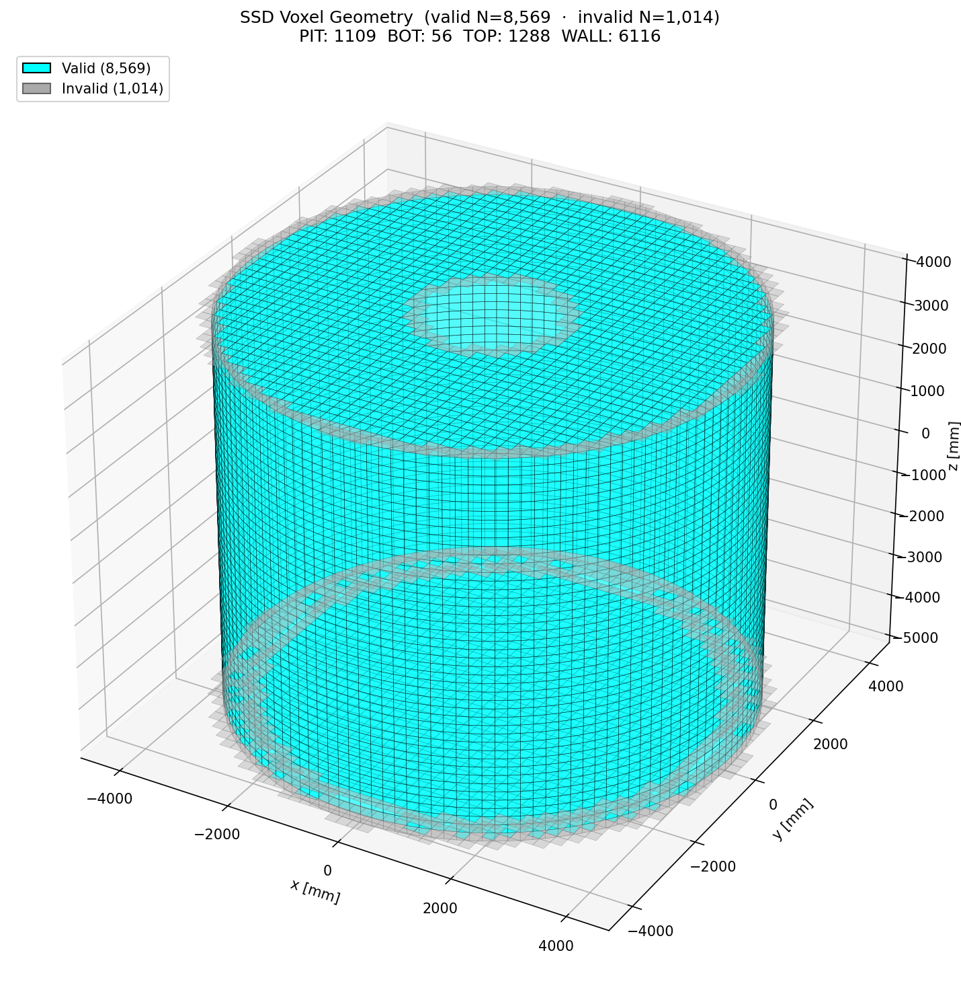
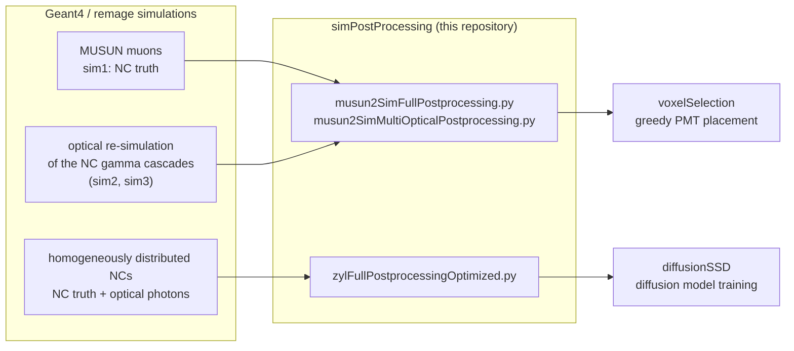

# simPostProcessing

Post-processing of Geant4/[remage](https://github.com/legend-exp/remage) simulations of neutron captures in the
LEGEND-1000 water tank. The scripts turn raw HDF5 simulation output into compact, ML-ready datasets
that are used to optimize the PMT placement of the neutron tagger, the photomultiplier system of the
water tank.

This repository is part of my master's thesis *"Optimisation of the LEGEND-1000 Neutron Tagger Using a
Surrogate Monte Carlo Simulation"* (Eberhard Karls Universität Tübingen).

## Background

LEGEND-1000 searches for neutrinoless double-beta decay of <sup>76</sup>Ge. One background is
<sup>77</sup>Ge, which is produced when cosmic-muon-induced neutrons are captured on <sup>76</sup>Ge.
The neutron multiplicity is the most promising parameter for a <sup>77</sup>Ge anti-coincidence
detector. A capture emits a gamma cascade, which produces optical photons that can be detected by PMTs in the water tank.

In the simulation, the inner surfaces of the tank (regions `pit`, `bot`, `wall` and `top`) are a
**sensitive surface detector (SSD)**, whose optical properties are an overlay of those of the PMTs
that can be placed and of the reflective foil that lines the rest of the wall. The SSD is divided into
**9583 voxels**, square tiles of 195 mm × 195 mm, which is the area of a PMT cathode with 110 mm
radius. Each voxel stands for one PMT position; 8569 of them can actually be occupied by a PMT, the
others (grey in the figure) cannot. For every simulated NC, this repository counts the detected
photons on all 9583 voxels; voxelSelection restricts the choice to the valid ones.

<p align="center">
  
</p>

## Pipeline overview



The output is used in two ways:

- **Voxel selection** ([voxelSelection](https://github.com/UniThommi/voxelSelection)): the NCs from
  the MUSUN muon simulation are used to optimize the detector. A greedy algorithm selects the voxels
  (PMT positions) based on the muon → NC relation and the NC light.
- **Surrogate model** ([diffusionSSD](https://github.com/UniThommi/diffusionSSD)): only the
  homogeneous NCs are used to train the diffusion model, which learns the voxel hit pattern of an NC
  from its properties. They are split into training and validation data.

The MUSUN muon, optical and homogeneous-NC simulations are produced with the remage applications in
[RMGApplications](https://github.com/UniThommi/RMGApplications).

## Core processing (`src/core/`)

| Script | Input | Output | Used for |
|---|---|---|---|
| `zylFullPostprocessingOptimized.py` | one simulation of homogeneously distributed NCs; NC truth and optical photons in the same file | `ncscore_output_0_train.hdf5`, `ncscore_output_0_validation.hdf5` | diffusion model |
| `musun2SimFullPostprocessing.py` | **sim1**: MUSUN muon simulation with the NC truth; **sim2**: optical re-simulation of every sim1 NC | `ncscore_output_0.hdf5` | voxel selection |
| `musun2SimMultiOpticalPostprocessing.py` | sim1 + sim2 + further optical simulations of the same NCs (**sim3**) | `ncscore_output_0.hdf5` (hits summed over all optical simulations) | voxel selection |

All three scripts share the same processing steps:

1. **Global IDs.** Every simulation file numbers its materials and physical volumes differently. The
   names are collected from all inputs and mapped to the global IDs in `src/mappings/`, so that
   `matID`/`volID` are comparable across files.
2. **NC matching.** Photons are assigned to the NC that produced them. In the single-simulation
   workflow the key is `(evtid, nC_track_id)` within one file. In the MUSUN workflow the key is
   `(run_id, muon_id, nc_id)`: sim2 photons carry the sim1 muon ID (`muon_track_id`) and NC ID, and
   `run_id` comes from the `run_NNN` directory, because muon and NC IDs are only unique within a run.
3. **Photon selection.** A photon is counted only if it
   - hits one of the SSD surfaces (detector UIDs 1965–1968),
   - arrives within **0–200 ns** after the capture, and
   - hits the surface **from inside the tank** (moving down at the bottom, up at the top, radially
     outwards at the wall), because photons arriving from outside could not be detected in reality.

   In the MUSUN workflow, photon and capture times come from two different simulations, and rounding
   can produce slightly negative time differences: values in [−1 ns, 0) are counted as 0, values below
   −1 ns are treated as an error and abort the run. The homogeneous-NC simulation starts with the
   capture at t = 0, so no tolerance is needed there.
4. **Voxel assignment.** Each selected photon is assigned to the voxel with the nearest center, using a
   `scipy.spatial.KDTree` that is queried once per chunk of photons. The hits are counted per NC and
   voxel.
5. **Features and output.** One row is written per NC, including NCs without any detected photon
   (all-zero target row). Rows are written in batches into resizable, LZF-compressed HDF5 datasets.

**Why several optical simulations (sim3)?** Because an SSD voxel combines the optical properties of a
PMT with those of the reflective foil, it reflects much more light than a real PMT. A single optical
simulation therefore yields a lower detection efficiency per voxel than a PMT would have. Summing the
hits of several optical simulations of the same NCs raises the voxel efficiency to that of a PMT.

### Scalability and robustness

The production datasets contain millions of NCs (the example output in
[`data_structure/`](data_structure/MLFormatSSDVoxelHitsDataStructure.txt) has 14.3 million NCs × 9583
voxels), so the scripts are built for long batch jobs:

- **Bounded memory:** photons are read in chunks whose size depends on the available RAM (`psutil`),
  and the output is written in batches.
- **Input checks before the expensive work:** the input files (in the MUSUN workflow the optical
  files) are opened once to detect truncated or corrupt files, which are listed in
  `faulty_simulations.txt`. The `run_NNN` / `sim_NNN` directory structure and the run sets of sim1,
  sim2 and sim3 are checked as well.
- **Resumable runs:** after an interruption, the same command continues where it stopped; `--reset`
  starts from scratch.
  - `zylFull…`: files are processed in batches; completed files are recorded in
    `processing_progress.json`, and the train/validation split is stored in `train_val_split.json`.
  - MUSUN scripts: the result of the optical scan is saved to `scan_checkpoint.npz`, and the number of
    fully written rows to `processing_progress.json`. A restart skips the scan, discards a partially
    written batch and writes only the missing NCs. It refuses to resume with different settings.
- **Leakage-free split:** the train/validation split of `zylFull…` is done per simulated event, so all
  NCs of one event end up in the same set.

## Output format

All row-aligned datasets have one row per NC (`N` rows):

| Dataset | Shape | Content |
|---|---|---|
| `phi_matrix` | N × 32, float32 | NC features, column names in `phi_columns` |
| `target_matrix` | N × 9583, int32 | detected photons per voxel, voxel indices in `target_columns` |
| `region_matrix` | N × 4, int32 | detected photons per region (`pit`, `bot`, `wall`, `top`) |
| `event_ids` | N × 3 (MUSUN) or N × 2 (homogeneous NCs), int64 | `(run_id, muon_id, nc_id)` or `(run_id, nc_id)`, names in `event_id_columns` |
| `weights` | N, float32 | constant 1/N_NC, with N_NC estimated from a sample of input files (not used by the downstream tools) |

The features in `phi_matrix`:

- **Position:** `xNC_mm`, `yNC_mm`, `zNC_mm`, `r_NC_mm`, `phi_NC_rad`, and the signed distances to the
  SSD `dist_to_wall_mm`, `dist_to_bot_mm`, `dist_to_top_mm` (positive inside)
- **Capture medium:** `matID`, `volID` (global material and physical-volume IDs)
- **Gamma cascade:** `#gamma`, `E_gamma_tot_keV`, energy and momentum components of up to four
  gammas (`gammaE1_keV`, `gammapx1`, … `gammapz4`), and their mean radial and axial momentum
  components `p_mean_r`, `p_mean_z`
- **Other:** capture time `nC_time_in_ns` and the <sup>77</sup>Ge flag `nC_flag_Ge77`

Static metadata: the voxel geometry (`voxels/` with center, layer and corners of every voxel, and
`voxel_metadata` with region flags and cylindrical coordinates of the voxel centers), the global
mappings (`mat_map/`, `vol_map/`), the SSD radius (`theta/inner_radius_in_mm`) and `primaries`. In
the MUSUN output, `primaries` is the number of simulated muons (runs × `--muons-per-run`); it is needed
to normalize <sup>77</sup>Ge rates to all muons, because the simulation output only contains muons
that interacted. In the homogeneous-NC output it is the number of NCs.

The complete layouts of the raw inputs and of the output are listed in `data_structure/`.

## Repository structure

```
simPostProcessing/
├── src/
│   ├── core/            post-processing entry points (see above)
│   ├── validation/      consistency checks of inputs and outputs
│   ├── evaluation/      analyses of raw and post-processed data
│   ├── hdf5_structure/  analyze_hdf5.py: text dump of the structure of an HDF5 file
│   ├── mappings/        global material (14) and physical-volume (576) ID mappings (JSON)
│   └── voxels/          voxel definition of the SSD: index, center, corners, region (JSON)
├── data_structure/      HDF5 layouts of the raw sim1 and sim2 files and of the ML output
├── docs/                figures used in this README
└── requirements.txt
```

The mapping files are extended in place when a simulation contains new materials or volumes; existing
IDs never change.

### Validation (`src/validation/`)

| Script | Checks |
|---|---|
| `validate_neutron_capture_consistency.py` | that sim1, the raw SSD and PMT optical simulations and the post-processed output contain exactly the same NCs, identified by `(run_id, muon_id, nc_id)`. This guards against optical simulations seeded from a different NC simulation, which would make SSD and PMT results incomparable. |
| `check_nc_duplicates.py` | that no NC appears in more than one `output_t*.hdf5` file of a run, and which files share duplicates |
| `verify_nc_counts_postprocessing.py` | that the single-simulation output contains as many NCs as the raw data (counts only; expects the file names of an earlier output version, see the module docstring) |

### Evaluation (`src/evaluation/`)

| Script | Content |
|---|---|
| `analyse_physVol_groups.py` | photon-hit spectra grouped by the physical volume in which the neutron was captured |
| `analyze_normalization_factors.py` | minimum and maximum of the features and targets of the diffusion-model data, used to find a suitable normalization for the diffusion model |
| `count_run_ids.py` | number of NCs per run in an output file |
| `unique_phys_vol_names_gdml.py` | list of the physical volume names in the GDML geometry |
| `analyze_orphaned_photons_from_raw.ipynb` | exploratory checks of the raw homogeneous-NC data: photon–NC matching, photon times, NC properties |

## Installation

Python 3.11 (tested with 3.11.15):

```bash
python3.11 -m venv .venv
source .venv/bin/activate          # Windows: .venv\Scripts\activate
pip install -r requirements.txt
```

With conda, create the environment with `conda create -n simpostprocessing python=3.11`, activate it
and run the same `pip install` command.

## Usage

The default paths of the mapping and voxel files point to the author's cluster installation, so pass
the files in this repository explicitly. Input directories contain one `run_NNN/` subdirectory per
simulation run when `--nested` is used:

```
sim1/run_000/output_t0.hdf5, output_t1.hdf5, ...
sim2/run_000/output_t0.hdf5, ...
sim3/run_000/sim_000/output_t0.hdf5, ...
```

**Homogeneous NCs (diffusion-model data):**

```bash
python src/core/zylFullPostprocessingOptimized.py \
    -i /path/to/simulation -o /path/to/output --nested \
    -m src/mappings/globalMaterialMappings.json \
    -v src/mappings/globalPhysVolMappings.json \
    -x src/voxels/currentDistZylVoxelsPMTSize.json
```

`--val-fraction` (default 0.2) and `--random-seed` (default 42) control the train/validation split.

**MUSUN workflow (voxel-selection data):**

```bash
python src/core/musun2SimFullPostprocessing.py \
    -i1 /path/to/sim1 -i2 /path/to/sim2 -o /path/to/output \
    --nested --muons-per-run <muons per run> \
    -m src/mappings/globalMaterialMappings.json \
    -v src/mappings/globalPhysVolMappings.json \
    -x src/voxels/currentDistZylVoxelsPMTSize.json
```

`--muons-per-run` is the number of muons each sim1 run was started with. For repeated optical
simulations, use `musun2SimMultiOpticalPostprocessing.py` with the additional argument
`-i3 /path/to/sim3`; `--sim3-runs 1 2 3` restricts the processing to selected runs.

**Consistency check of the MUSUN data products:**

```bash
python src/validation/validate_neutron_capture_consistency.py \
    --sim1 /path/to/sim1 --raw-ssd /path/to/sim2 \
    --postprocessed-ssd /path/to/output/ncscore_output_0.hdf5 \
    --pmt /path/to/raw_pmt_simulation
```

The command-line scripts print all options with `--help`.

## Related repositories

- [RMGApplications](https://github.com/UniThommi/RMGApplications): Geant4/remage applications for the
  MUSUN muon, optical and homogeneous-NC simulations
- [voxelSelection](https://github.com/UniThommi/voxelSelection): greedy PMT placement on the voxel hit
  data
- [diffusionSSD](https://github.com/UniThommi/diffusionSSD): diffusion model trained on the
  homogeneous-NC data

---

Thomas Bürger, Eberhard Karls Universität Tübingen
